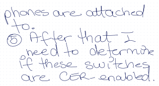

# Handwriting recognition training materials

Ground-truth pairs for improving the pipeline's OCR (`src/ocr.py`,
tesseract): each row pairs the original handwriting image with what
the OCR actually produced and what it *should* have produced. Keep one
row per sample; more samples of the same misread word are worth more
than long paragraphs.

**Reading this file:** the pretty, fully rendered version lives on
GitHub — `training/README.md` in `giselleakal/LiveScribe-Echo-Pen`.
Notepad shows the raw text underneath; edit there, read on GitHub.

## Training table

| Original | Transcription | Correction |
|---|---|---|
|  | hones are attached a too-to-to-to-to-to-to-to-to-to-to- O After that I need to determine D. D. D. if these switches are COR-enabled. | phones are attached to.  (5) After that I need to determine if these switches are CER-enabled. |

## How to add a sample (workflow)

1. **Save the handwriting image** to Windows `Downloads`
   (`C:\Users\gisel\Downloads\`). PNG preferred; any readable image works.
2. **Tell the agent** "new sample in Downloads" — it copies the image
   into `samples/`, runs the OCR to fill the middle column, adds the
   table row, and commits, then pushes so the GitHub view is current.
   The human fills in the Correction column (the ground truth) either
   directly or by telling the agent.
3. Edit this file in Notepad via the Windows path
   `\\wsl.localhost\Ubuntu\home\giselle\echo\training` — editing here
   edits the repo copy directly; the agent commits and pushes it.
4. **Read the rendered version** on GitHub (refresh the page after the
   agent pushes).

## Conventions

- **Sample naming:** sample number = the `NN` in the source page's
  `Notes_Mmm_DD_NN_…` filename (Nov 12 page 05 → `sample_05.png`), so
  every sample's name points straight back to the page it came from.
  Page titles in the library (`Notes_Nov_12_01`…`05`) follow the same
  scheme, so UI title ↔ sample file ↔ table row all agree.
- **Circled numbers:** transcribe the circled ⑤ as `(5)` — one
  convention, used consistently in every ground truth.
- **Transcription column** must be the OCR's *actual* output, never
  cleaned up — that is the training signal. Corrections go in the third
  column only. ` ` inside a cell marks a line break; it renders as
  a line break on GitHub but shows as literal text in Notepad.

## Misreads worth targeted training (so far)

- `ph` → `h`, `phones` → `hones`
- `5` → `O` / `to`
- `CER` → `COR` / `D.`
- Short function words after a line break are worst; connected-cursive
  phrases (determine, switches, attached) survive best.

## Per-sample sources

- **Sample 05** — `Notes_Nov_12_05_Image_OCR.png` (Windows Downloads),
  written on Echo dot paper, 2026-11-12.
